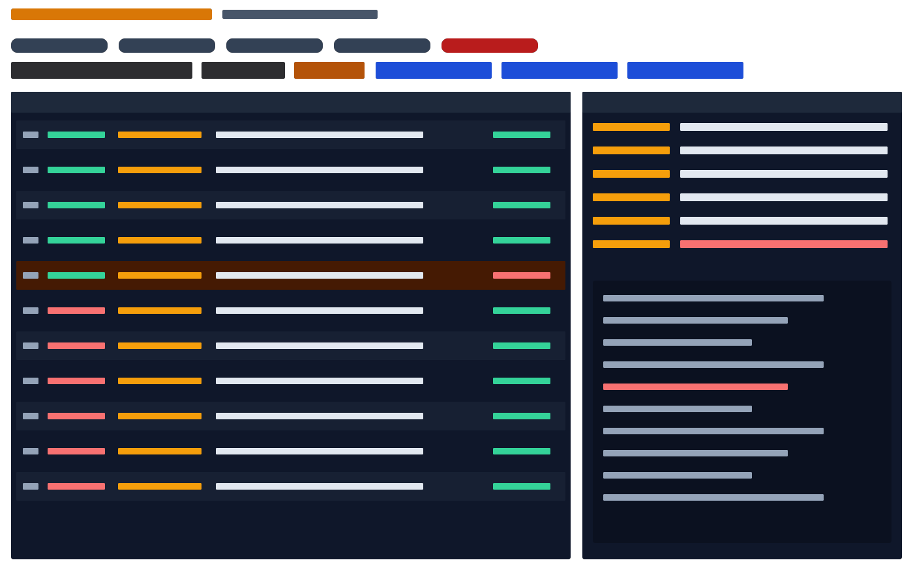

# Claude Config & Hooks Viewer for VS Code

Inspect Claude Code `.claude/settings.json` and hook configuration files in the editor without running any shell commands. Team repositories often accumulate nested `permissions.allow`, `permissions.deny`, `PreToolUse`, `PostToolUse`, `Notification` hooks and environment variables where an overly broad `Bash(*)` rule, a risky shell pipeline or a plaintext API token can hide in raw JSON. This extension parses Claude settings locally in plain JavaScript with no network calls and no cloud upload.

## What it opens

- Claude Code settings files (`.claude/settings.json`, `.claude/settings.local.json`, `claude.settings.json`, `*.claude.json`).
- Any open `.json` settings file via the Command Palette or Explorer context menu (Open in Claude Config & Hooks Viewer).
- Nothing to install, no commands executed, nothing uploaded.

## The free part

- Allow and deny permission explorer: lists every `allow`, `deny` and `ask` rule with tool name, argument pattern, decision and risk level.
- Hook table with shell-command inspection: inspects `PreToolUse`, `PostToolUse`, `Notification`, `Stop` and other hook events with matchers, command strings and timeout settings.
- Masked environment variable viewer: displays configured `env` entries with secret-looking values masked by default and a local reveal toggle for safe screen sharing.
- Static safety checks: flags broad Bash wildcards (`Bash(*)`, `Bash(sudo *)`, `Bash(rm *)`), risky hook commands (`rm -rf`, `curl | sh`, `eval`), plaintext tokens, `bypassPermissions` mode and conflicting allow/deny rules.
- Search and filter: filter rules by tool, pattern, decision or safety status offline.

## The Pro tools, with 1 free try

Pro adds the team audit, comparison and documentation steps: generate a Markdown safety and permission audit report across one file or a folder, compare two Claude settings files (such as project `.claude/settings.json` vs `.claude/settings.local.json`) in Markdown, or export redacted Markdown and CSV permission and hook documentation locally. Your first try of each Pro tool is free. Zovo Pro is USD 19 once, and the team licence is USD 59.

## Why not raw JSON

Raw JSON makes it easy to miss a broad `Bash(*)` wildcard buried in a long allow list, a `curl | sh` hook in `PostToolUse` or a live token pasted into `env`. A local inspector puts permissions, hooks, masked environment variables and safety findings on one screen without running a single command.

## More tools by Zovo

See full docs and install options at [vscode.zovo.one/extensions/zovo-claude-hooks-viewer/](https://vscode.zovo.one/extensions/zovo-claude-hooks-viewer/), browse all Zovo VS Code extensions at [vscode.zovo.one](https://vscode.zovo.one/), or explore [Zovo Pro](https://vscode.zovo.one/pro/).
